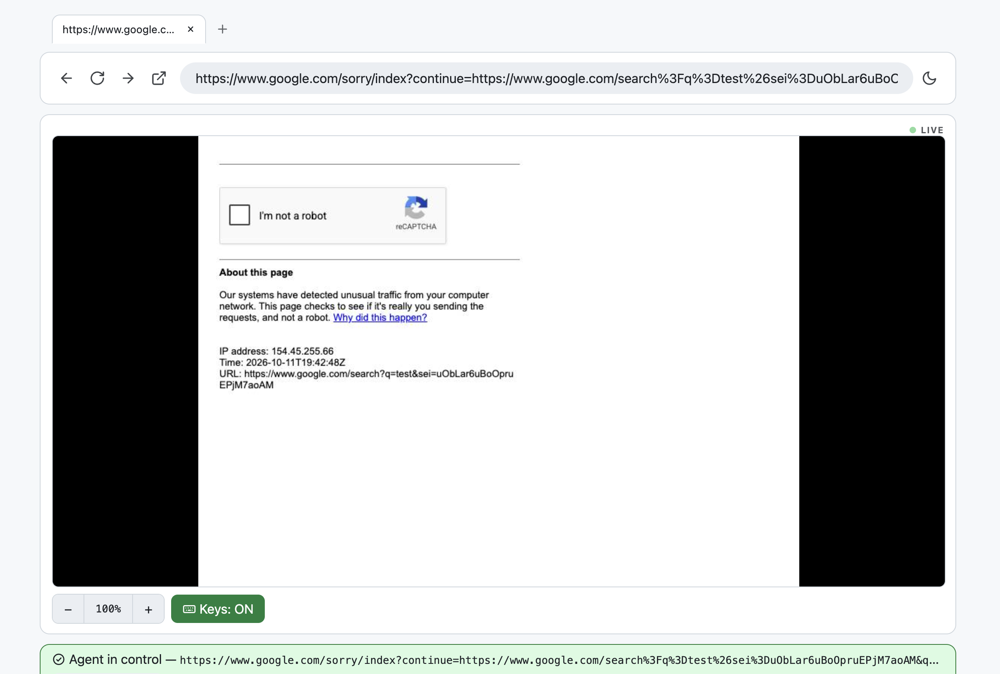

<p align="center">
  <picture>
    <source media="(prefers-color-scheme: dark)" srcset="src-tauri/icons/Square71x71Logo.png">
    
  </picture>
</p>

<h1 align="center">Live Browser</h1>

<p align="center">A browser for you and your agent to control and view the tab, at the same time.</p>

> Drive any page from the CLI (`lb click`, `lb type`, `lb snapshot`, …) while
watching the live view — and grab control yourself for logins, captchas, and
judgment calls, then hand back. You can see where agents get stuck and unstuck them by using the Web UI, just like the way how you use the browser.



```
agent drives via CLI  ──►  lb web (Chrome via CDP + JSON API)
                                     │
user watches + takes over ──►  web UI (live screenshot, handover banner)
```

## The core loop (why this exists)

```sh
# 1. Remote agent opens a page (in place — plain `lb open` opens a NEW tab each time)
lb open --here https://example.com

# 2. User watches the running page live at the web ui

# 3. Agent reads + acts
lb snapshot            # [ref] tag "name" list of interactive elements
lb shot                # JPEG screenshot
lb wait 7              # block until element [7] appears (kills load races)
lb click 3
lb hover --on 5        # hover element [5] (menus, tooltips)
lb type 1 "ada@example.com" --submit

# 4. Agent hits a login wall → asks the human to take over.
#    This blocks until the human clicks "Done" in the web UI.
lb handover "please log in, then click Done in the UI"

# 5. Human logs in using the real browser window, clicks Done.
#    Normally it's hard to unblock this since the browser is running on a server
#    You need to either give credential in the prompt or setup remote desktop 

# 6. Agent re-reads the (now logged-in) tab and continues
lb snapshot
lb click 7
...
```

## Quickstart (Paste this to your agent e.g. OpenCode / OpenClaw)
```
Set up live-browser on this machine by following https://raw.githubusercontent.com/anslwy/live-browser/main/docs/agent-setup.md: install the `lb` CLI if missing, start `lb web` on port 8765, add `lb mcp` as an MCP server to my agent config, then verify with `lb status` and report back the live web UI URL.
```

## Manual Install (If you prefer to setup the CLI & WebUI & MCP yourself)

Linux / macOS:

```sh
curl -fsSL https://raw.githubusercontent.com/anslwy/live-browser/main/install.sh | bash
```

Windows (PowerShell):

```powershell
irm https://raw.githubusercontent.com/anslwy/live-browser/main/install.ps1 | iex
```

Then:

```sh
export PATH="$HOME/.local/bin:$PATH"  # if not already set
lb web --port 8765
```

## MCP (`lb mcp`)

The same actions as JSON-RPC tools on stdio — for opencode, Claude Code, etc.
The daemon must be running (`lb web`); `lb mcp` is a stateless bridge to it
(`handover_request` returns immediately — poll `handover_status` instead of
blocking like `lb handover` does). `tab_link` returns a shareable UI link
(`/?tabId=N`) that opens the UI focused on that tab.

```json
"mcp": {
  "live-browser": {
    "type": "local",
    "command": ["lb", "mcp"],
    "environment": { "LB_SERVER": "http://127.0.0.1:8765" },
    "enabled": true
  }
}
```

## Development

Requires Chrome/Chromium and Node (for the UI build).

```sh
cargo build                      # builds the `lb` binary (target/debug/lb)
cd web && npm install && npm run build   # builds the monitor UI into web/dist
```

## Run

```sh
# Headless (default): no visible browser window. `lb web` backgrounds by
# default (survives terminal close, logs to `daemon-<port>.log`); if a server
# is already running on the port it just shows the URL instead of starting
# a second one. The web UI auto-opens in your default browser on start
# (unless --no-open; best-effort from a background daemon).
lb web --port 8765

# Keep the server in the terminal instead (logs to stdout; e.g. debugging,
# or under supervisors like systemd Type=simple that background for you):
lb web --port 8765 --foreground

# Headed: visible browser window so a human can watch and take over.
lb web --port 8765 --headed

# Containers / servers without a GUI:
lb web --port 8765 --no-sandbox --no-open

# Stop / restart the server (port flag goes before the subcommand;
# restart backgrounds by default too — add --foreground to keep it terminal):
lb web --port 8765 stop
lb web --port 8765 restart

# Useful server flags:
#   --background / --detach (explicit background; the default — overrides --foreground)
#   --foreground  (stay in the terminal; overrides --background)

# Useful server flags:
#   --chrome /path/to/chrome   (auto-detects /usr/bin/google-chrome-stable)
#   --profile DIR              (persistent profile; keeps logins)
#   --url URL                  (page to open on start)
#   --passcode CODE             (optional API+UI guard; env LB_PASSCODE)
```

## Bot-walled sites (403s)

Some sites (CloudFront WAF, x.com, …) block stock automated Chrome. When a
site 403s, try go to the web UI: the gear icon next to the address bar → Browser section lists and select CloakBrowser.

You can also manually point `lb` at a stealth Chromium via the existing `--chrome`
flag — it is an opt-in dependency, not bundled:

```sh
# CloakBrowser (https://github.com/CloakHQ/CloakBrowser) — patched Chromium;
# free older build, latest via free/paid key:
npm install cloakbrowser && npx cloakbrowser install
# `npx cloakbrowser info` shows the exact binary path (versioned dir):
lb web --port 8765 --chrome ~/.cloakbrowser/chromium-*/chrome
```

## Passcode
By default all devices in the same network can view and control the web UI. It's better to setup `LB_PASSCODE` if more than one person will be using the network.
```sh
LB_PASSCODE=secret lb web --port 8765          # set it (env preferred over --passcode flag, which leaks via `ps`)
LB_PASSCODE=secret lb status                      # every CLI command needs the same value
# Web UI asks for the passcode once and remembers it in localStorage.
# Raw HTTP also works:  curl -H "x-lb-passcode: secret" http://127.0.0.1:8765/api/status
# (Bearer token, Basic-auth password, or ?passcode=secret are accepted too.)
```

Set a default server once and drop the flag: `export LB_SERVER=http://127.0.0.1:8765`.

## CLI reference

| Command | What it does |
|---|---|
| `lb web [--port N] [flags]` | Start the browser + web UI server (background by default; `--foreground` stays in the terminal; old `lb daemon` still works) |
| `lb web --port N stop` | Stop the running server |
| `lb web --port N restart` | Stop (if running) and start a new server |
| `lb web --port N link [tab]` | Print a shareable UI link for a tab (`/?tabId=N`, default: active) |
| `lb update [--force]` | Update to the latest release (reports when already current) |
| `lb open <URL\|text> [--here]` | New tab with URL (plain text searches Google); `--here` reuses the active tab |
| `lb status` | URL, title, handover state |
| `lb list` | All tabs (stale tabs flagged when a renderer is wedged) |
| `lb close [tab]` | Close a tab (never hangs, even on wedged pages) |
| `lb use <tab>` | Switch the active tab |
| `lb snapshot [--full]` | Interactive elements as `[ref] tag "name"` (`--json` for full JSON, `--full` for type/value/frame/coords) |
| `lb shot [--out f.jpg]` | Save a JPEG screenshot (`--out -` prints base64) |
| `lb click <ref\|css=…> [--double\|--right]` | Click by snapshot ref or CSS selector (same-origin iframes included) |
| `lb click-at <x> <y> [--double\|--right]` | Click at viewport coordinates (CSS pixels) |
| `lb hover <x> <y> \| --on <ref\|css=…>` | Move mouse (hover states, tooltips, menus) |
| `lb type <ref> <text> [--submit] [--append]` | Type into an input (Enter with `--submit`; `--append` keeps content) |
| `lb press <key\|chord>` | Key press (`Enter`, `F5`, …) or chord (`ctrl+c`, `ctrl+shift+t`, `alt+F4`) |
| `lb wait <ref\|css=…> [--timeout s] [--gone]` | Block until an element appears (or disappears) |
| `lb text [ref\|css=…] [--max N]` | Visible text of the page or one element |
| `lb html [ref\|css=…] [--max N]` | HTML of the page or one element |
| `lb upload <ref> <file>` | Attach a local file to an `<input type=file>` |
| `lb downloads` | Files downloaded through the browser (newest first) |
| `lb scroll [dx] [dy]` | Scroll the page (default: down 600px) |
| `lb wheel <x> <y> [dy] [dx] [--dy N] [--dx N]` | Trackpad-style scroll of whatever is under the point (inner containers too; flags override positionals) |
| `lb drag <x1> <y1> <x2> <y2>` | Mouse drag — text selection, sliders, resize handles, DnD |
| `lb insert <text>` | Fast paste at the cursor (focus target first) |
| `lb select <ref> <value>` | Set a dropdown option by value or visible text |
| `lb zoom [in\|out\|reset]` | Page zoom for small viewports (persists across navigations) |
| `lb eval <js>` | Run JS, print JSON-ified result (JS errors reported readably) |
| `lb back / forward / reload` | History navigation |
| `lb handover "msg" [--timeout s]` | Request human takeover, block until Done |
| `lb claim ["msg"]` | Claim control as human (same as UI "Take control") |
| `lb handover-done` | End handover (human scripts/tests) |
| `lb mcp` | MCP server on stdio (below) — same actions as the CLI, for agents |
| `lb log` | Recent action log (includes auto-dismissed JS dialogs) |

Targets accept a snapshot ref (`lb click 12`) or a raw CSS selector
(`lb click css=.login-button`).

Notes:

- **Tabs:** `lb open` without `--here` (or `--tab`) opens a *new* tab every
  time. Reuse the active tab with `lb open --here <url>` (or navigate a
  specific one with `--tab N`), or you will pile up tabs.
- **JS dialogs** (`alert`/`confirm`/`prompt`) are auto-dismissed by the
  daemon (logged as `dialog` in `lb log`) so one popup can never wedge a
  tab or the daemon. `beforeunload` is accepted.
- **Screenshots are JPEG** (quality 70), not PNG — despite any `.png`
  filename you choose. Default output is `screenshot.jpg`.
- **Snapshots pierce same-origin iframes** (flagged `frame=iframe[0]` in
  `--full`/`--json`, with viewport `@x,y` coordinates). Truly cross-origin
  frames stay invisible — use `lb click-at` with UI coordinates there.
- **Downloads** land in `<profile>/downloads` (`lb downloads` lists them).

## Web UI (http://127.0.0.1:8765/ by default)

- **Live page view** — always-on coalesced polling (no blink, no scroll jump).
  **Click** the screenshot to click · **drag** on it to drag (select text, sliders, resize panes) ·
  **move the mouse** over it for hover states · **scroll wheel** over it to scroll the container under the cursor.
  A fake cursor + ripple marks the agent's latest click so you can follow along.
- **Snapshot table** (collapsed) — every row has a **click** button; `input`/`textarea` rows also get a
  **type** box (Send / Send + Enter). No separate browser window needed.
- **Handover banner** — appears when the agent runs `lb handover`; human takes over the
  browser window, then clicks **Done — return to agent**
- **Open / back / reload** controls and **action log**
- **Deep link** — open `/?tabId=N` (from `lb web link N` / `tab_link`) to focus
  that tab on load; invalid or missing ids show an error instead of switching.

Dev mode: `cd web && npm run dev` (proxies `/api` to the daemon on :8765).

## API (for scripts)

`GET /api/status`, `POST /api/open`, `GET /api/snapshot`, `GET /api/screenshot` (JPEG),
`GET /api/metrics`, `POST /api/click|click-at|hover|type|type-raw|insert|press|key|eval|nav|scroll|wheel|drag|zoom|select|wait|text|html|upload`,
`GET /api/downloads`, `GET /api/handover`, `POST /api/handover/request|claim|done`,
`GET /api/log`. All POSTs take/return JSON with `{ok: …}`.

## Layout

```
src/main.rs    CLI entry (clap)
src/cli.rs     command definitions
src/client.rs  thin HTTP client (each command → daemon API)
src/daemon.rs  Chrome (chromiumoxide/CDP) + Axum API + static UI server
src/webctl.rs  `lb web stop`/`restart` (pidfile lifecycle)
src/update.rs  `lb update` + startup update reminder
web/           Svelte 5 + TS + Vite monitor app (build → web/dist)
```
